# Architecture and Design

*Owner: [Author] (overall design and the Factory pattern). The Adapter pattern is described in [[Event Capture]] and the Strategy pattern in [[Export JSON and PDF]].*

## How an event flows through the extension

Every BlueJ event goes through five steps:

| Step | Class | What it does |
| --- | --- | --- |
| 1. Listen | `TelemetryListener` | Receives every event from BlueJ; the only class (with `SimpleExtension` and `TelemetryMenu`) that needs BlueJ running |
| 2. Adapt | `EventAdapterFactory` + `*EventAdapter` | The factory picks the adapter for the event's type; the adapter turns the event into a `TelemetryRecord` |
| 3. Track | `ClassTracker`, `EditTracker` | Work out what BlueJ doesn't report directly: classes created, methods added, bursts of typing |
| 4. Aggregate | `TelemetryAggregator` | Calculates every summary number from the list of records |
| 5. Export | `TelemetryExporter` → `JsonExporter`, `PdfExporter` | Write the session to a file |

Steps 2–5 are plain Java with no BlueJ code, so they are unit tested without the BlueJ GUI (see [[Testing]]). Time is injected with `java.time.Clock`, so timing tests always give the same result.

## Entry point

`SimpleExtension` extends BlueJ's `Extension` class. BlueJ calls:

- `startup(BlueJ)`: creates the `TelemetryListener`, registers it with `addExtensionEventListener`, and adds the Tools menu item (`TelemetryMenu`)
- `terminate()`: exports the session when BlueJ quits
- `isCompatible()`: requires extensions API version 3 or later (BlueJ 5+)

## The record model

Every event becomes a `TelemetryRecord`:

| Field | Example |
| --- | --- |
| `timestamp` | `2026-11-17T20:01:00Z` |
| `category` | `COMPILE`, `INVOCATION`, `CLASS`, `PROJECT`, `LIFECYCLE`, `EDIT` |
| `eventType` | `COMPILE_ERROR` |
| `attributes` | `{"line": 3, "message": "';' expected", "errorType": "';' expected"}` |

`addAttribute` rejects a null key and skips null values, so the JSON never contains `null` attributes. `getAttributes()` is read-only.

## Design patterns

| Pattern | Classes | Problem it solves |
| --- | --- | --- |
| **Factory** | `EventAdapterFactory` | The listener shouldn't need an `instanceof` chain to pick an adapter. The factory keeps a `Map<Class, EventAdapter>` and `adapterFor(event)` returns the right one, or `null` for unsupported events. A new event type is supported by calling `register(type, adapter)`. |
| **Adapter** | `EventAdapter` → `CompileEventAdapter`, `InvocationFinishedEventAdapter`, `ClassEventAdapter`, `PackageEventAdapter` | Each BlueJ event class has a different shape; each adapter converts one into the common `TelemetryRecord`. See [[Event Capture]]. |
| **Strategy** | `TelemetryExporter` → `JsonExporter`, `PdfExporter` | Each output format is an interchangeable strategy; the listener loops over its list of exporters. See [[Export JSON and PDF]]. |

Singleton is not used (as required). The listener is created once in `SimpleExtension.startup()` and passed to the menu.

## SOLID principles

| Principle | In this project |
| --- | --- |
| Single responsibility | Adapters convert, trackers detect changes, the aggregator calculates, exporters write files |
| Open/closed | New event types are registered in the factory; new output formats are new exporters; existing classes don't change |
| Liskov substitution | Any `EventAdapter` or `TelemetryExporter` can replace another; the listener only uses the interfaces |
| Interface segregation | `EventAdapter` has one method; `TelemetryExporter` has two |
| Dependency inversion | The listener depends on the `EventAdapter` and `TelemetryExporter` abstractions; time comes from an injected `Clock` |

## Class diagram

Visibility: `+` public, `-` private, `~` package-private; `$` marks static methods. Private helper methods are left out.

```mermaid
classDiagram
    direction TB

    class Extension {
        <<BlueJ API>>
    }
    class ExtensionEventListener {
        <<BlueJ API>>
    }
    class MenuGenerator {
        <<BlueJ API>>
    }

    class SimpleExtension {
        -TelemetryListener listener
        +startup(BlueJ bluej) void
        +terminate() void
        +isCompatible() boolean
        +getName() String
    }
    class TelemetryMenu {
        -TelemetryListener listener
        +getToolsMenuItem(BPackage pkg) MenuItem
    }
    class TelemetryListener {
        -List~TelemetryRecord~ records
        -EventAdapterFactory factory
        -List~TelemetryExporter~ exporters
        -ClassTracker classTracker
        -EditTracker editTracker
        -Map~String, BClass~ methodsToCheck
        -Instant sessionStart
        -String projectName
        -Path outputDir
        +eventOccurred(ExtensionEvent event) void
        +exportNow() List~Path~
        +exportSnapshot() List~Path~
        +getRecords() List~TelemetryRecord~
    }

    class EventAdapterFactory {
        -Map~Class, EventAdapter~ adapters
        +register(type, adapter) void
        +adapterFor(ExtensionEvent event) EventAdapter
        +adapterFor(Class eventType) EventAdapter
    }
    class EventAdapter {
        <<interface>>
        +adapt(ExtensionEvent event) TelemetryRecord
    }
    class CompileEventAdapter {
        -Clock clock
        +adapt(ExtensionEvent event) TelemetryRecord
        ~build(type, files, line, message) TelemetryRecord
        ~errorType(String message)$ String
    }
    class InvocationFinishedEventAdapter {
        -Clock clock
        +adapt(ExtensionEvent event) TelemetryRecord
        ~build(type, className, methodName, objectName, params, result) TelemetryRecord
        ~summarize(Object result)$ String
    }
    class ClassEventAdapter {
        -Clock clock
        +adapt(ExtensionEvent event) TelemetryRecord
        ~build(type, className, oldName, hasError) TelemetryRecord
    }
    class PackageEventAdapter {
        -Clock clock
        +adapt(ExtensionEvent event) TelemetryRecord
        ~openedType(folderCreated, now)$ String
        ~build(type, projectName, classCount) TelemetryRecord
    }

    class TelemetryRecord {
        -Instant timestamp
        -String category
        -String eventType
        -String details
        -Map~String, Object~ attributes
        +getTimestamp() Instant
        +getCategory() String
        +getEventType() String
        +addAttribute(String key, Object value) void
        +getAttributes() Map~String, Object~
    }
    class ClassTracker {
        -Clock clock
        -Set~String~ knownClasses
        -Set~String~ newClasses
        -Map~String, Set~ knownMethods
        +baseline(Set~String~ classes) void
        +updateClasses(current) List~TelemetryRecord~
        +updateMethods(className, current) List~TelemetryRecord~
    }
    class EditTracker {
        -Duration burstGap
        -int edits
        -int charsInserted
        -int charsDeleted
        +onEdit(cls, time, inserted, deleted, added, removed) List~TelemetryRecord~
        +flush() List~TelemetryRecord~
    }

    class TelemetryAggregator {
        -List~TelemetryRecord~ records
        -Duration idleThreshold
        +compileAttempts() long
        +compileSuccessRate() double
        +errorsPerCompileAttempt() double
        +errorFrequency() Map~String, Long~
        +runCount() long
        +exceptionCount() long
        +activeTime() Duration
        +idleTime() Duration
        +typingCadenceMs() double
        +editsPerActiveMinute() double
        +creationTimeline() List~Map~
    }
    class SessionMetadata {
        -String studentId
        -String projectName
        -Instant sessionStart
        -Instant sessionEnd
        -long totalSessionSeconds
        -long totalCompilationAttempts
    }
    class TelemetryExporter {
        <<interface>>
        +fileExtension() String
        +export(meta, stats, records, out) void
    }
    class JsonExporter {
        -Gson gson
        +fileExtension() String
        +export(...) void
    }
    class PdfExporter {
        -DateTimeFormatter timeFormat
        +fileExtension() String
        +export(...) void
    }
    class PdfDocument {
        -List~StringBuilder~ pages
        ~addTitle(String text) void
        ~addHeading(String text) void
        ~addTable(headers, rows, columnWidths) void
        ~addBarChart(labels, values, valueLabels) void
        ~save(OutputStream out) void
    }

    SimpleExtension --|> Extension
    TelemetryMenu --|> MenuGenerator
    TelemetryListener ..|> ExtensionEventListener

    SimpleExtension *-- TelemetryListener : creates
    SimpleExtension ..> TelemetryMenu : registers
    TelemetryMenu --> TelemetryListener : exportSnapshot()

    TelemetryListener *-- EventAdapterFactory
    TelemetryListener *-- ClassTracker
    TelemetryListener *-- EditTracker
    TelemetryListener o-- "1..*" TelemetryExporter : exporters
    TelemetryListener o-- "*" TelemetryRecord : records
    TelemetryListener ..> TelemetryAggregator : creates on export
    TelemetryListener ..> SessionMetadata : creates on export

    EventAdapterFactory o-- "*" EventAdapter : adapters
    CompileEventAdapter ..|> EventAdapter
    InvocationFinishedEventAdapter ..|> EventAdapter
    ClassEventAdapter ..|> EventAdapter
    PackageEventAdapter ..|> EventAdapter
    EventAdapter ..> TelemetryRecord : produces

    ClassTracker ..> TelemetryRecord : produces
    EditTracker ..> TelemetryRecord : produces
    TelemetryAggregator o-- "*" TelemetryRecord

    JsonExporter ..|> TelemetryExporter
    PdfExporter ..|> TelemetryExporter
    PdfExporter ..> PdfDocument : uses
    TelemetryExporter ..> SessionMetadata
    TelemetryExporter ..> TelemetryAggregator

    note for EventAdapter "Adapter pattern"
    note for EventAdapterFactory "Factory pattern"
    note for TelemetryExporter "Strategy pattern"
```

